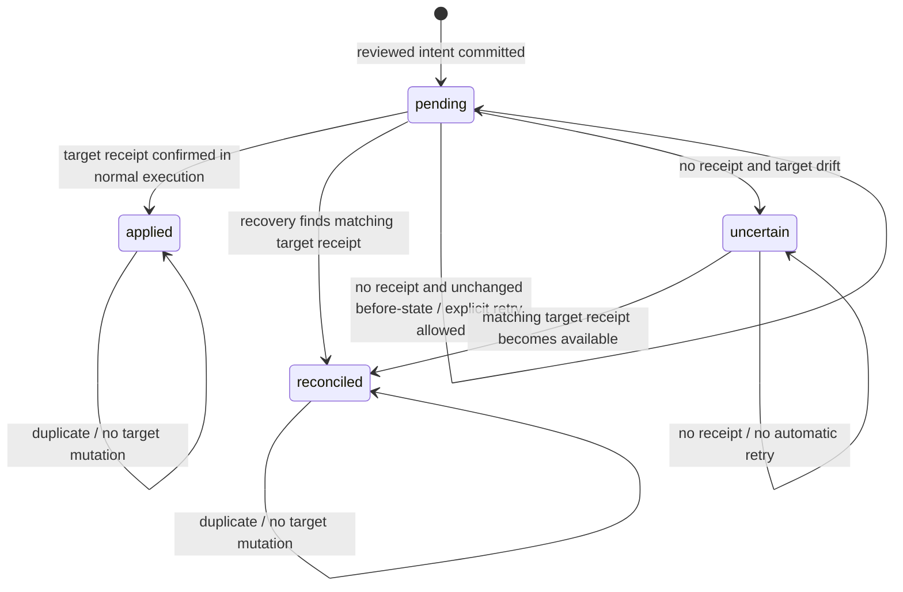

# Persistent execution and crash recovery / Persistência e recuperação

Available in the **v0.4.0 GitHub source/release**. Use the checkout commands
below. The npm version remains independently published; do not assume a GitHub
release is already available on npm.

Requires Node.js **22.13+**, using built-in `node:sqlite`. Node 22 may print an
experimental-feature warning. No runtime dependency installation or AWS account.
The `durable` command explicitly creates local files; the older memory-only
commands retain their original behavior.

## Português: reproduza a queda e a recuperação

Use uma pasta local dedicada. Execute os comandos individualmente; a saída 86
no ponto de falha é intencional.

```sh
git clone https://github.com/fernando-moretes/lab-security-remediation.git
cd lab-security-remediation
git checkout v0.4.0
node bin/cli.mjs durable init ./exercise.sqlite
node bin/cli.mjs durable plan ./exercise.sqlite > proposal.json
```

Leia `proposal.json`: recurso, estado anterior, estado proposto, versão e digest.
A aprovação pelo CLI continua sendo uma simulação explícita, não uma identidade
autenticada. Depois da revisão:

```sh
node bin/cli.mjs durable run ./exercise.sqlite proposal.json --approve --crash after-target
```

O processo termina com código **86**, depois de confirmar a mudança sintética
e o recibo, mas antes de confirmar o resultado no ledger. Agora, em outro processo:

```sh
node bin/cli.mjs durable inspect ./exercise.sqlite
node bin/cli.mjs durable recover ./exercise.sqlite synthetic-finding-001
node bin/cli.mjs durable run ./exercise.sqlite proposal.json --approve
```

Resultado esperado:

- Antes da recuperação: operação `pending`, alvo na versão 2, um recibo.
- Após recuperação: operação `reconciled`, com o mesmo alvo na versão 2.
- Repetir a proposta preserva a versão 2 e o único recibo; não reaplica.

Mantenha a proposta original ao retomar. Gerar outra proposta após a mudança
cria um digest diferente e o mesmo ID de finding será rejeitado por conflito.

### Resultado incerto

Em uma **nova** base, gere uma nova proposta e interrompa em `after-intent`.
Antes de recuperar, simule uma mudança externa:

```sh
node bin/cli.mjs durable drift ./exercise.sqlite true
node bin/cli.mjs durable recover ./exercise.sqlite synthetic-finding-001
```

O estado passa a `uncertain`, com código de saída **2**. Encontrar um booleano
igual ao desejado não prova que nossa operação foi executada. Sem recibo,
a recuperação não altera o alvo e a repetição permanece bloqueada.
Não apague o registro para contornar a incerteza.

## State machine



`recover()` changes only ledger status and its audit event. It never performs
the target mutation. A `pending` result with `retryable: true` permits a caller
to submit the exact reviewed request explicitly. It is not a retry scheduler.
The target precondition is checked again inside the write transaction.

`applied` and `reconciled` prove historical application through this adapter's
receipt, not that current state has remained unchanged. Later drift is returned
as `driftAfterReceipt: true`, without restoring or reapplying anything.

## Storage and transaction boundaries

One dedicated SQLite file contains:

| Table | Role |
| --- | --- |
| `operations` | Unique finding ID, proposal digest and JSON, simulated reviewer, status |
| `target` | One synthetic resource with monotonic version and boolean |
| `receipts` | One receipt per operation, binding digest to resulting version/state |
| `events` | Ordered ledger transition history; no deletion/TTL |

Execution intentionally uses **three separate transactions**:

1. Persist reviewed intent and `pending` audit event.
2. Compare the target version/state, change the target and insert its receipt
   **in the same transaction**.
3. Confirm the ledger status as `applied`.

`BEGIN IMMEDIATE` serializes writers. A conditional target update prevents two
distinct operations based on the same version from both applying. A conflicting
digest cannot reuse an operation ID. WAL mode and `synchronous=FULL` are used;
lock contention waits up to five seconds and then surfaces an error.

The ledger and target share a file for this teaching exercise, but their commits
are intentionally separate to expose the uncertain-outcome window. A simpler
all-in-one transaction could remove that window for this local case. Real remote
targets generally cannot join a local SQLite transaction.

**Important boundary:** the target mutation and receipt are atomic here. This
is stronger than an arbitrary AWS API. A conditional write in DynamoDB cannot,
by itself, make a separate AWS API side effect atomic. A remote adapter needs
documented idempotency/receipt semantics or must stop on uncertain outcomes.
Never treat the boolean alone as proof of ownership of a remote side effect.

## Failure matrix and automated evidence

`npm test` runs real subprocesses that call `process.exit(86)` at each point.
It then opens a fresh connection/process and verifies persisted state.

| Point | State after process exit | Recovery |
| --- | --- | --- |
| `after-intent` | pending, target unchanged, no receipt | pending, explicit retry possible |
| `target-before-commit` | target transaction interrupted | rollback to unchanged target; explicit retry possible |
| `after-target` | target + receipt committed, ledger pending | reconciled, no second effect |
| `ledger-before-commit` | target + receipt committed, ledger transaction interrupted | reconciled |
| `after-ledger` | ledger already applied; acknowledgement lost | applied, duplicate does not reapply |

Additional tests cover:

- Six simultaneously released subprocesses processing the same request.
- Conflicting payloads using the same operation ID.
- Distinct operation IDs racing for the same target version.
- Tampered digest and absent approval leaving no intent or side effect.
- Drift without a receipt producing `uncertain`.
- Drift after a committed receipt preserving current state.
- Reopening, initialization refusing existing files, foreign/corrupt files.
- The documented CLI workflow and a packed-package installation smoke test.

These are process-interruption and logical-concurrency tests. They do **not**
simulate physical power loss, disk/controller failures, network filesystems,
multi-host distributed consensus or malicious database editing.

## API

```js
import { initializeDurableLab, DurableLab } from "./durable.mjs";
import { propose, approve, finding } from "./lab.mjs";

initializeDurableLab("./my-lab.sqlite"); // refuses any existing path
const lab = new DurableLab("./my-lab.sqlite");
try {
  const state = lab.inspect().state;
  const proposal = propose(finding, state);
  const approval = approve(proposal, state, "synthetic-reviewer");
  console.log(lab.execute(proposal, approval));
  console.log(lab.recover(finding.id));
} finally {
  lab.close();
}
```

The API also exposes `simulateDrift(boolean)` as an explicit teaching aid.
Fault hooks are for trusted test code only; no user-supplied JavaScript is
evaluated. The npm subpath is `/durable` when a release containing it is published.

## Operating limits, retention and cleanup

- Only the local synthetic bucket is supported. ASFF review candidates remain
  non-executable and cannot be passed directly to this executor.
- The reviewer is a label, not authenticated identity. No expiry, revocation,
  signed approval, encryption, tamper-proof audit or authorization service.
- Use a trusted, dedicated local directory. Do not open untrusted SQLite files.
  Schema markers and integrity checks prevent accidental reuse, not adversarial
  tampering. No migrations or automatic resets are performed.
- Initialization requires an existing parent directory and a nonexistent file.
  If initialization fails midway, preserve the failed file for inspection and
  choose a new path; it is not silently replaced.
- Receipts and operation IDs persist for the life of the database. There is no
  garbage collection. Deleting/restoring a database changes the idempotency
  boundary; replays outside retained history are not protected.
- No durable automatic rollback is implemented. Restoring unsafe configuration
  needs a separately reviewed compensation design. The original memory-only
  `rollback()` does not operate on this database.
- Close every process before copying or cleaning up. SQLite may create
  `<database>-wal` and `<database>-shm` files. Never remove WAL files from a live
  database or copy only the main file while writers are active.
- For a disposable exercise, stop all users of the lab and delete only its
  dedicated database, remaining sidecar files and your proposal file. No cloud
  cleanup is required.
- `durable inspect` does not mutate application state, but opening the database
  can create SQLite sidecar files or perform normal journal housekeeping.

## Sources / Fontes

- [Node.js SQLite documentation](https://nodejs.org/api/sqlite.html)
- [SQLite transactions](https://sqlite.org/lang_transaction.html)
- [SQLite PRAGMA settings](https://sqlite.org/pragma.html)

Next: authenticated review (issue #7) and a separately designed isolated AWS
adapter (issue #8). This implementation establishes local evidence and limits,
not a production readiness claim.
