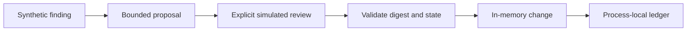

# Security remediation review lab — v0.1.0

Fernando Azevedo · 20 October 2026 · MIT

[](https://github.com/fernando-moretes/lab-security-remediation/actions/workflows/test.yml)

**[Contribute / Contribuir](CONTRIBUTING.md) · [Roadmap](ROADMAP.md) ·
[Report a result / Relatar teste](https://github.com/fernando-moretes/lab-security-remediation/issues/new/choose) ·
[Security](SECURITY.md)**

Running a group session? Use the [40-minute facilitator guide](WORKSHOP.md).
Para uma sessão em grupo, use o [roteiro de 40 minutos](WORKSHOP.md).

```sh
git clone https://github.com/fernando-moretes/lab-security-remediation.git
cd lab-security-remediation
npm test
```

No dependency installation required / Não precisa instalar dependências.
Forks, issues and pull requests are welcome in Portuguese or English.



## Português

Exercício local de revisão de remediações inspirado em findings de segurança
na AWS. Objetivo: distinguir uma proposta de mudança de uma mudança autorizada.
Esta versão não usa AWS, não chama modelos e não cria recursos. O finding e o
bucket são sintéticos; não é uma integração com o AWS Security Hub nem um
controle completo de S3.

### Execute em aproximadamente 15 minutos

Requisito: Node.js 22 ou superior, disponível em https://nodejs.org/.
Baixe `lab.mjs` e leia o código antes de executar. Nenhum pacote precisa ser
instalado, nenhuma credencial é solicitada.

```sh
node lab.mjs --self-test
node lab.mjs
# Leia before, after, resource e digest antes de aprovar:
node lab.mjs --approve
```

Resultado esperado: sete testes aprovados; a execução sem flag apenas propõe;
com `--approve`, `status` é `simulated-change` e `blockPublicAccess` passa a true.
O digest vincula a revisão ao conteúdo exato da proposta. Ele não autentica o
revisor: a aprovação é simulada pelo argumento explícito do CLI.

Fluxo: finding sintético → proposta limitada → revisão → verificação de versão
e digest → alteração em memória → registro de idempotência.

### Experimente as falhas

Leia `selfTest()`: ausência de aprovação, entrega duplicada, alteração depois da
aprovação, drift, campo extra pedindo administração, rollback sem revisão e
replay conflitante. Cada teste verifica um comportamento observável; não são
apenas instruções textuais para um agente.

Perguntas para discutir:
1. Por que um HTTP 200 de um modelo não autoriza uma mudança?
2. O que ocorre se um worker cair entre a mudança e a gravação do ledger?
3. Como revogar uma aprovação? Como autenticar quem aprovou?
4. Por que o rollback para um estado inseguro também exige revisão?

### Limitações

O ledger e o estado vivem no mesmo processo e desaparecem ao terminar.
Não há concorrência distribuída, persistência, autorização IAM, aprovação
assinada, TTL ou integração ASFF. O teste de campo extra não comprova resistência
geral a prompt injection. A representação booleana não cobre os quatro campos
reais de S3 Block Public Access. O custo de AWS é zero nesta versão porque não
há chamadas de rede; isso não estima o custo de uma implementação real.

Próxima fase: adaptador somente leitura, finding ASFF sanitizado, aprovação
autenticada, ledger durável com conditional writes, recuperação após falha,
medição de custo e limpeza verificável, em ambiente isolado.

### Compartilhe o resultado

Envie feedback pelo contato público no site https://fernando.moretes.com:
versão do Node, sistema operacional, testes aprovados/falhos, etapa onde
travou, tempo aproximado e uma melhoria sugerida. Não envie credenciais,
IDs de conta, findings reais ou dados de clientes. Nome/citação só serão
publicados com autorização separada. Executar o lab não envia telemetria.

Limpeza: o exercício não grava arquivos e não cria recursos. Exclua somente
os arquivos que você baixou ou os relatórios que você mesmo salvou.

## English

A local security-remediation review exercise inspired by AWS findings.
Learning goal: distinguish a proposed change from an authorized change.
This release uses a synthetic finding and an in-memory bucket; it makes no
AWS or model calls and creates no cloud resources.

Requires Node.js 22+. Download and inspect `lab.mjs`, then run:

```sh
node lab.mjs --self-test
node lab.mjs
# Review before, after, resource and digest:
node lab.mjs --approve
```

Expect seven passing tests. Without a flag, the CLI only proposes. With
`--approve`, the result is `simulated-change`, setting the in-memory
`blockPublicAccess` flag to true. The digest binds approval to proposal
contents; it does not authenticate the reviewer.

Tests cover missing approval, duplicate delivery, proposal tampering, state
drift, unsupported fields/resource scope, reviewed rollback and conflicting
replays. Read `selfTest()` and explain why each failure must stop the workflow.

This is not a Security Hub integration or production authorization system.
The ledger is process-local and ephemeral. There is no distributed atomicity,
IAM authorization, signed approval, expiry, ASFF adapter or crash recovery.
The boolean is not a complete S3 Block Public Access configuration. The
unknown-field test does not prove general prompt-injection resistance.

Discuss: what if a worker crashes after a side effect but before recording it?
How would an authenticated reviewer revoke approval? Why must rollback also
be reviewed? These are requirements for the future cloud implementation.

Feedback: Node version, OS, passing/failing tests, blocking step, approximate
time and one suggestion, through https://fernando.moretes.com. Do not share
credentials, customer data or real findings. Attribution requires separate
consent. No telemetry is sent. Cleanup only involves files you downloaded or
reports you explicitly saved; the lab itself writes no files.

## Sources / Fontes

- https://docs.aws.amazon.com/securityhub/latest/userguide/securityhub-findings-format.html
- https://docs.aws.amazon.com/AWSSimpleQueueService/latest/SQSDeveloperGuide/standard-queues-at-least-once-delivery.html
- https://docs.aws.amazon.com/AmazonS3/latest/userguide/access-control-block-public-access.html
- https://docs.aws.amazon.com/amazondynamodb/latest/developerguide/Expressions.ConditionExpressions.html
